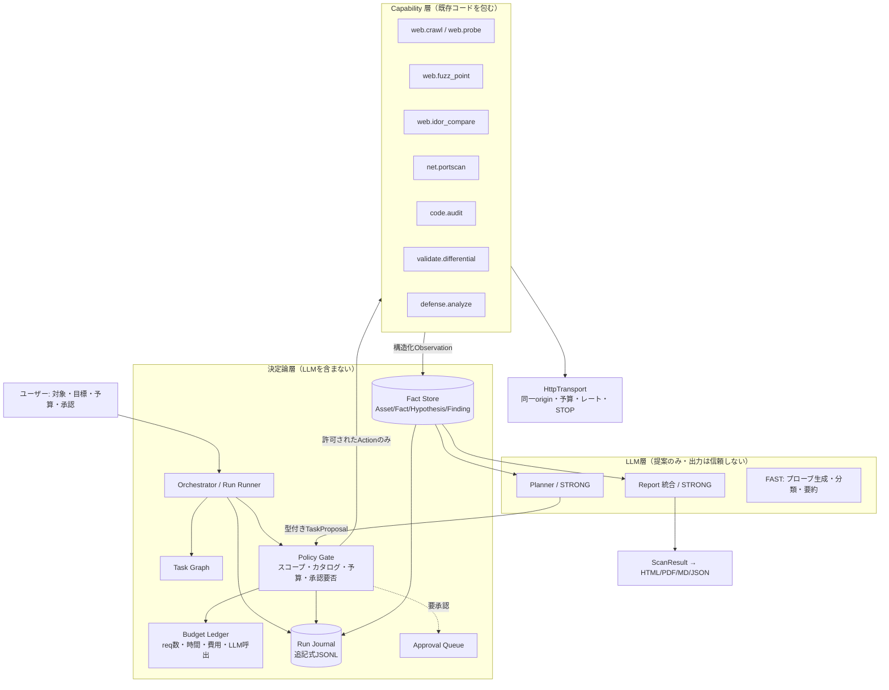
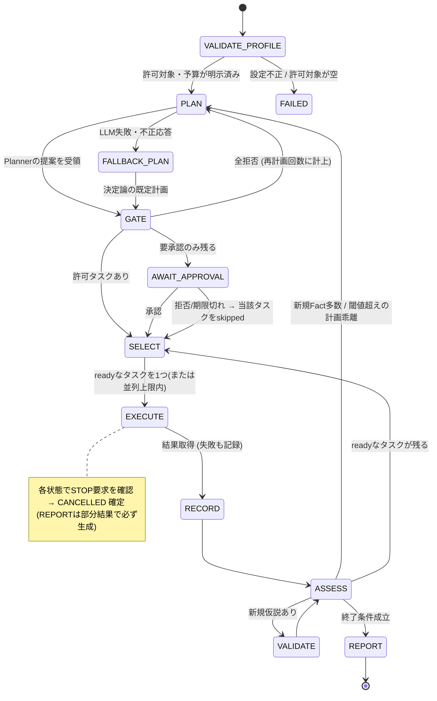

# 自律完結型診断プラットフォーム 設計書（設計フェーズ・レビュー待ち）

作成: 2026-10-21。改訂: 同日（ユーザー提供の調査レポートを§2.4に反映）。状態: **提案（未承認）**。本書の内容はすべて未実装の設計であり、現行機能の説明ではない。
調査はソースの静的確認と公開資料の読解のみ。外部ターゲットへの診断・実LLMでの評価・セルフテストの再実行は行っていない
（テスト件数は AGENTS.md §4 に記録された値の引用で、今回再計測していない）。

## 0. 位置づけと既存文書との関係

| 文書 | 本書との関係 |
|---|---|
| [PRACTICAL_ROADMAP.md](PRACTICAL_ROADMAP.md) | **実装順序の正本のまま**。本書は置き換えない。§8で本書のPhaseを既存ID（P1.2〜P4.3）へ対応づけ、重複する作業（P3.1のrunner、P3.2の台帳）は新設せず共有する |
| [AGENT_ARCHITECTURE.md](AGENT_ARCHITECTURE.md) | STRONG/FAST・エフォート・検証器の規約を**そのまま継承**する。Plannerは STRONG、機械的生成は FAST |
| [DESIGN.md](DESIGN.md) | 現行構成の記述。本書§1は実コードで再確認した結果であり、食い違いがあれば本書§1を優先して DESIGN.md を直す |
| [AGENTS.md](../AGENTS.md) | 安全境界（検出のみ・非DoS・同一オリジン・ローカル保存）は不変。本書はこれを**緩めず**、実行層で強制する範囲を広げる方向の設計 |
| [AUTONOMOUS_PHASE_A_DESIGN.md](AUTONOMOUS_PHASE_A_DESIGN.md) | 最初に着手するPhaseの詳細設計（§9相当） |

「自律完結」の定義（依頼書に従う）: **許可された安全な範囲内で、人間の逐次指示なしに診断を完了できること。**
無制限に操作を実行することではない。

---

## 1. 現状アーキテクチャ分析

### 1.1 機能の実装状況（コードとテストで確認）

分類基準: **実装済み**＝コードがあり、固定テストまたはselftestが経路を通す。**部分実装**＝経路はあるが
範囲・配線・検証に欠ける。**未実装**＝コード・テストがない（設計文書のみを含む）。

| 領域 | 分類 | 根拠 | 補足・欠けている点 |
|---|---|---|---|
| CODE AUDIT（標準） | 実装済み | `agents/audit_agent.py`（7ステップ、ASTプリスキャン、CVE照合、検証パス）、`tools/test_audit_evidence.py` | 単一ファイル入力・12,000文字切り詰め。複数ファイル解析は未実装（P4.2） |
| CODE AUDIT（LangGraph） | 部分実装 | `core/orchestrator.py`、`agents/langgraph_audit_agent.py` | **固定5ノードのグラフ**で、分岐はCRITICAL検出時の深層解析ループ1か所のみ。計画・タスク分解・チェックポイントはない |
| ATTACK MODE | 実装済み（偵察＋仮説＋ローカルPoC文書化） | `agents/recon_agent.py`（10ステップ）、`EXPLOIT_TRANSMISSION_ENABLED = False` と `_assert_no_transmission()` | PoCはLLM生成してreports/pocへ保存するのみで対象へ送信する経路がない。**送信は共通送信層を通らない**（§1.2） |
| ATTACK: CTF能動探索 | 実装済み（独立機能・既定OFF） | `core/ctf_safety.py`（破壊的パターン拒否・予算・連続エラー停止）、`tools/run_selftest.py` の `test_ctf_active_retrieval` | 独自の送信ラッパー。本計画は権限を拡張しない（PRACTICAL_ROADMAP §3の方針を継承） |
| WEB FUZZ | 実装済み | `agents/fuzz_agent.py`（7ステップ）、`tools/web_fuzzer.py`、`core/http_transport.py` | 検出は兆候観測。SSTI/XSS/IDORの判定ヒューリスティックの品質は未評価（P2.2） |
| DEFENSE MODE | 部分実装 | `agents/monitor_agent.py`、`tools/log_watcher.py` | ローテーション/縮小/部分行は未対応（P4.3）。MITRE ATT&CKタグ付けの課題は既知の未解決事項 |
| STRONG/FAST・エフォート・検証器 | 実装済み | `core/model_router.py`、`agents/base_agent.py`（`_stream_llm`/`_complete_llm`/`_verify_findings`/`_vote_findings`） | テレメトリは助言のみ（自動切替なしは意図的） |
| スコープ判定 | 部分実装 | `core/scope_guard.py`、`BaseAgent._check_scope()` | **既定は `allowed_targets=[]`（無効）かつ `scope_mode="warn"`**（`core/config.py`）。許可リスト一致のみで除外リスト非対応 |
| 通信境界（同一origin・共有予算・レート・停止・応答上限） | 部分実装 | `core/http_transport.py` を使うのは `tools/web_fuzzer.py` のみ（grepで確認） | `WebProber` は `allow_redirects=True` の直接 `session.get`、`subdomain_enum`/`cve_client` も独立。ATTACKは未保護 |
| 構造化所見・実行状態 | 実装済み | `core/findings.py`、`BaseAgent._finalize()`（RESULT→DONEを一度だけ）、`tools/test_structured_reports.py` | 全4モード+LangGraphが同契約。`engagement_id` は常に `"default"` |
| 証拠保存・マスキング | 実装済み（P1.2は未完了扱い） | `core/evidence_store.py`、`core/redaction.py`、`tools/test_*_evidence.py` | 既定OFF（`save_evidence`）。GUI目視・実LLMでの引用挙動・ATTACK画面ログのマスクは未了 |
| レポート（HTML/PDF/MD/JSON） | 実装済み | `tools/report_generator.py`、`tools/pdf_writer.py`、`gui/export_util.py` | 確定ScanResultから生成。再検証・差分は未実装 |
| 停止機構 | 実装済み（協調的） | `BaseAgent.stop()`/`is_stopped()`、`HttpTransport._sleep_interruptible` | 進行中の同期HTTPはtimeoutまで残る。強制中断ではない |
| **タスク計画・再計画** | **未実装** | 該当コードなし。各エージェントの `run()` はステップ固定の直線処理 | 本書の中心課題 |
| **実行状態の永続化・再開** | **未実装** | `_finalize()` が最終結果をイベントで返すのみ。途中状態を保存しない | `reports/telemetry.jsonl`・`reports/investigation/*.md`・証拠ファイルは**結果の記録**であり再開用の状態ではない |
| **判断・実行の監査ログ** | **未実装** | `_log()` は `bus.log` でGUIへ送るのみ。LLMの入出力・ポリシー判断は保存されない | CTFのみ `format_log()` に送信履歴がある |
| **ヘッドレス実行（CLI）** | **未実装** | P3.1 は設計のみ | 自律実行はGUIスレッド前提では運用しにくい |
| **ベンチマーク・正解データ** | **未実装** | `testlab/vuln_server.py`（模擬サーバー1本）があるのみ。ground truthなし | P2.1 は未着手。品質の主張はできない |
| CI | 部分実装 | `.github/workflows/selftest.yml`（`SELFTEST_NON_LLM_ONLY=1`） | 一部の「非LLM」項目は外部ネットワークに到達する（AGENTS.md §3参照）。オフライン完全対応ではない |

### 1.2 自律化の観点で重要な構造的事実

1. **制御フローがコードに埋め込まれている。** 4エージェントとも1スレッド1回きりの直線パイプラインで、次に何をするかをデータ（タスク）として保持しない。計画・優先順位付け・再計画・重複抑止の入れ物がない。
2. **安全境界が「ツール個別」であり「実行層で統一」されていない。** WEB FUZZは `HttpTransport` が唯一の送信口になっているが、Recon系（`WebProber`・`NetworkScanner`・`subdomain_enum`）とCTF能動探索は別々の送信経路を持つ。PlannerがこれらをLLMの指示で呼べるようにした時点で、境界の抜け穴が**LLMから到達可能**になる。
3. **スコープの既定が「無効」。** 後方互換のための設計（AGENTS.md §3に警告表示ルールあり）だが、自律実行では「空の許可リスト＝全許可」は許容できない。
4. **データ契約は先行して整っている。** `ScanResult`/`Finding`/`CoverageItem`/`EvidenceStore`/`redaction` は自律化の基盤として再利用できる。足りないのは**実行途中の状態**（タスク、事実、判断）であり、結果の型ではない。
5. **品質を測る手段がない。** P2.1が未着手のまま自律化すると、「賢くなった」を検証できず、退行にも気づけない。

---

## 2. ARTEXおよび関連技術との比較

### 2.1 ARTEXについて確認できたこと

| 項目 | 情報 | 確度 |
|---|---|---|
| 概要 | Go製のオープンソース・マルチエージェント型の自律ペネトレーションテストシステム。2026-07-26にAGPL-3.0で公開、百度BSRC系のチャレンジで入賞と報道 | 報道（二次情報） |
| 構成 | 「dual-graph（二重グラフ）」アーキテクチャと称されるが、**ノード・エッジが何を表すかは確認できた資料に記述なし** | 名称のみ確認。中身は不明 |
| 役割分担 | Plannerがターゲットをタスクへ分解し、Workerが実行する。Workerはログを共有し、他のWorkerの次の行動に影響する | 報道（CSAのリサーチノートが二次引用） |
| ツール | シェルコマンド、HTTPリクエスト、ポートスキャン等の実ツール実行 | 報道 |
| 永続化・再開・Human-in-the-loop・再計画方式 | **確認できた資料に記述なし** | 不明 |
| 運用上の注意 | 2026年10月、CrowdStrikeが同ツールの関与する韓国金融機関への侵入活動を報告（CSAが引用）。ただし**当局・被害側は関与を未確認**、作者は無関係を主張し更新停止・非公開化を表明 | 報道。断定しない |

**2026-10-21追記**: 上表は私が直接確認できた範囲（報道・CSA）。その後ユーザーが提供した調査レポート
（`deep-research-report.md`）が派生版コードに基づく内部設計を報告しており、**§2.4 に反映した**。
上表の「不明」だった項目（グラフの意味、永続化、再開、承認）はレポート上では「派生版確認」として一部補われているが、
**私自身は派生版のコードを取得・確認していない**ため、レポートの記述を二次情報として扱う。

調査上の判断: 作者が非公開化を表明し、悪用の報告もあるため、**私はARTEX本体・派生版のソースコードを取得・実行していない**。
レポートによれば派生版（ScopeWeaver）はAGPL-3.0のため、コードの流用はせず、設計思想のみを参考にする（clean-room方針。§2.4）。

### 2.2 一般的な自律ペンテスト技術（ARTEX固有ではない）

検索で確認できた範囲の一般的パターン（出典: [Cochise（arXiv 2502.04227）](https://arxiv.org/pdf/2502.04227)、[LLM駆動ペンテストのサーベイ（arXiv 2607.02605）](https://arxiv.org/pdf/2607.02605)、[LLM+古典プランニング（arXiv 2512.11143）](https://arxiv.org/html/2512.11143v1)）:

- **PentestGPT系: ペンテストタスクツリー（PTT）。** 木構造で戦略を保持。並列サブタスクや前のノードへの復帰を表しにくい。
- **VulnBot系: ペンテストタスクグラフ（PTG）。** DAGで独立タスクの並列スケジュールが可能。
- **Planner/Executor分離。** 計画（高レベル戦略）と実行（ツール呼び出し）を別コンポーネントにし、新しい発見でタスク木/グラフを更新して次のタスクと必要な文脈を選ぶ。
- **古典プランニングとLLMの併用。** 状態から可能な行動集合を決定論的に導き、LLMは選択・実行を担う。

### 2.3 観点別比較と採否

| 観点 | 一般的な自律ペンテスト | 本プラットフォームの現状 | 本設計での方針 |
|---|---|---|---|
| Planner/Worker | PlannerがタスクをWorkerへ割当 | Plannerなし。Workerに相当する4エージェントは固定パイプライン | **採用**。ただしPlannerは**型付きの行動カタログから選ぶだけ**で、任意コマンドは生成させない |
| タスク分解・再計画 | 木/DAGを新証拠で更新 | なし | **採用**（型付きタスクDAG、再計画回数に上限） |
| 探索履歴・資産情報の永続化 | 共有ログ、グラフ | 結果のみ保存 | **採用**（追記式ジャーナル＋事実ストア。§3） |
| エージェント間の情報共有 | ログ共有 | EventBusはGUI向けでエージェント間共有ではない | **採用**（共有は事実ストア経由のみ。生ログをプロンプトに連結しない） |
| 仮説更新 | 実行結果で更新 | AUDITの深層ループ、FUZZのトリアージが部分的 | **採用**（仮説は `Hypothesis` として証拠IDを持つ） |
| ツール選択 | LLMが任意ツール/シェルを選択・組立て | 固定 | **限定採用**。カタログ内のcapability選択のみ。**シェル実行は採用しない** |
| 証拠収集と検証評価 | 実エクスプロイトで成否確認する系統が多い | 検出のみ、検証器は文章上の敵対的レビュー | **変更して採用**。検証は**非破壊の差分再観測**に限定（§3.4）。実エクスプロイトによる成否確認は採用しない |
| Human-in-the-loop | 実装は系統により差 | CTF能動探索の事前スコープ指定のみ | **強化して採用**。実害の可能性がある行動は個別承認（§6） |
| 長時間タスクの再開・復旧 | 公開資料では不明確 | なし | **採用**（ジャーナル再生による再開。再開時にスコープ・認証を再検査） |
| 攻撃的機能（横展開、権限昇格、永続化、データ窃取） | 実装する系統がある | 非実装（AGENTS.md §3の方針） | **取り込まない**。必要性（診断品質への寄与）より、悪用時の被害と安全境界の毀損が大きい |

### 2.4 調査レポート（deep-research-report.md）の反映

ユーザー提供のレポートを、本書の設計に次のように取り込んだ。**レポートの出典（派生版コード・報道）は私が独立に再確認していない**。
一方、レポートの `ai-security-audit` 側の記述（空allow-listが許可になる、`HttpTransport`がWEB FUZZ中心、永続Run状態なし等）は、
§1 で私がコードを確認した内容と一致した。

**信頼度の扱い**

| 区分 | 内容 |
|---|---|
| 派生版確認（レポート報告） | Planner/Worker分離（PlannerだけがIntentを生成、Workerは1 Intentを処理して終了）／Asset GraphとExploration Graphの二層／状態変化でPlannerをwake／approvalの永続化／evidence versioning／restart時のresume／`exhausted`と`done`の区別 |
| 未確認（レポート自身が明記） | 閉鎖前の公式ARTEXに上記全てがあったか／PoCのライフサイクル管理／WSJの「約80社」とGMO調査の関係 |
| ライセンス注意 | レポートによれば派生版はAGPL-3.0。本リポジトリはMIT（`LICENSE`で確認）。**コードは取り込まず設計思想のみ**。必要なら法務確認 |
| 数値 | 工数（person-days）はレポート筆者の概算で、私は検証していない。本書の規模見積もり（行数）とは別物として扱う |

**取り込む点（本書の設計への反映先）**

| レポートの提案 | 判断 | 反映先 |
|---|---|---|
| 二層Graph（Asset＝対象の事実、Exploration＝診断の進捗） | **採用** | §3.4 Fact Storeを二層に分割。Assetに `candidate`/`authorized` を持たせる |
| Plannerが唯一のIntent生成者、Workerは1 Intentで終了 | **採用** | §3.4 Task Graph。本書の「Task」＝レポートの「Intent」 |
| 状態変化イベントでのみPlannerをwake（定期実行しない） | **採用** | §5 の `ASSESS → PLAN` 遷移条件、コスト低減 |
| `exhausted`（max_turns/予算到達）を `done` と区別 | **採用** | §5.2、coverageの `tested` にしない |
| evidence_version / report_evidence_versionの分離 | **採用（Phase F）** | 古い証拠に基づく「確認済み」を拒否 |
| 承認のタイムアウトは常にdeny | **採用** | §6.2 |
| 発見資産をscopeへ自動昇格しない | **採用（元から同方針）** | §6.3 |
| 全通信MITM録画を既定ONにしない | **採用（元から同方針）** | 既存の「必要な証拠だけ・保存前マスク」を維持 |
| 汎用Bash/Kali実行を与えない | **採用（元から同方針）** | §3.5(1) 案B |
| リスク4段階（R0〜R3）を決定論で再分類（LLMの自己申告を信用しない） | **採用（名称は本書のT0〜T3を維持）** | 対応: R0=T0、R1=T1、R2=T2+T3、R3=禁止。差は、レポートのR2が「個別承認または案件で事前明示」なのに対し、本書はT2を自動可・T3を個別承認に分けている点 |
| fault injection試験（Planner直後・Worker前・Observation保存後Finding保存前・Budget更新前後・Evidence保存途中でkill） | **採用** | §7.1 中断・再開、Phase Bのテスト |
| lease/heartbeatによるclaim、二重実行防止 | **採用（Phase B）** | §5.3 |
| hard stop一覧（連続Policy違反提案でWorker停止、不正な構造化出力N回でAgent停止、Evidence書込失敗時のconfirmed昇格禁止 など） | **採用** | §5.1 に追記 |
| DNS再解決してから送信（`dns_revalidate_before_send`） | **採用（要調査）** | 下記 |
| Worker trace index、Retest Agent | 後続（Phase F以降） | 優先度B |

**DNSに関する新たな確認事項**: `core/http_transport.py` と `core/scope_guard.py` に名前解決（`getaddrinfo` 等）の呼び出しはない（grepで確認）。
許可リストは**ホスト名文字列の比較**であり、許可ホスト名が内部IPに解決される場合（DNSの付け替え等）を防いでいない可能性がある。
`scope_guard.py` の docstring にも「DNS解決は行わない」とある。自律実行では送信直前に解決先IPを再検査する要否を、Phase Aの設計レビューで決める（現時点で脆弱性と断定はしていない。再現確認は未実施）。

**レポートと本書で判断が分かれる点**

| 論点 | レポート | 本書の判断 |
|---|---|---|
| 永続化 | SQLite（WAL）で `RunStore`/`AssetStore`/`ExplorationStore`。PostgreSQLは不要 | **レポート案に寄せる**: 実行状態（claim/lease/予算/Intent状態）は原子性が要るため標準ライブラリ`sqlite3`（WAL）を正とし、判断・実行の監査記録は追記式JSONLで別に持つ。P3.2が決めた「所見台帳はJSONLでSQLite不採用（v1）」は**所見台帳の話**であり、実行状態ストアは別の関心事として切り分ける。ただし二重の永続化機構になるため、§9で決定を仰ぐ |
| 最初の実装 | P1.2→P2.1完了直後に RunStore/AssetStore/ExplorationStore | 方針は同じ。本書はさらに「型付きAction→Policy Gate→既存送信口→ジャーナル」（Phase A）を先に小さく通す案。Phase AはP2.1の基準値を必要としないので並行可能だが、**P2.1完了を待ってからでも依存関係は破綻しない** |
| Worker Pool（N並列） | Intentをclaimして並列実行 | Phase A〜Cは**逐次実行**（`HttpTransport`は低並列・ジッター前提で、並列Workerは予算とレートの設計を増やす）。並列化はPhase C以降で必要性を測ってから |
| 工数 | Phase A 5〜8日、B 8〜15日、C 10〜20日 | 検証していない。参考値として併記するにとどめる |

---

## 3. 目標アーキテクチャ

### 3.1 設計原則

1. **LLMは提案し、決定論コードが許可する（LLM proposes, Policy Gate disposes）。** LLM出力は常に信頼しないデータとして扱い、実行前に型検査とポリシー検査を通す。
2. **オーケストレーターはLLMではない。** 状態遷移・予算・終了条件・再開は決定論的なコードで行う。
3. **既存エージェントを書き換えず、capability（実行可能な診断能力）として包む。** 大規模な全面書き換えをしない。
4. **共有状態は構造化された事実のみ。** 対象HTML・コードコメント・ログの本文は「信頼しない入力」としてデータ区画に入れ、そこにある指示でスコープ・予算・行動を変えない（P1.1の方針を継承）。
5. **実行したこと、拒否したこと、その理由を全て追記式ジャーナルに残す。**

### 3.2 役割構成（仮案からの統合・変更）

| 依頼書の仮案 | 本設計での扱い | 理由 |
|---|---|---|
| Orchestrator | **決定論的ランナー**（`core/autonomy/` に新設）。LLMを含まない | 予算・停止・再開は予測可能でなければならない |
| Planner Agent | LLM（STRONG）。**タスク提案のみ**。実行権限なし | 計画の自由度を上げても、実行できる範囲はカタログとポリシーで固定 |
| Recon Agent | 既存 `ReconAgent`/`WebProber`/`NetworkScanner` を capability 化 | 既存資産の再利用。ただし**共通送信層へ移行してから**Plannerに公開（Phase E） |
| Audit Agent | 既存 `AuditAgent`/LangGraph版を capability 化 | 同上。複数ファイル対応はP4.2 |
| Validation Agent | **新規**（Phase D）。非破壊の差分再観測と誤検知評価 | 現状の検証器は文章レビューで、再観測をしない |
| Defense Agent | 既存 `MonitorAgent`。**攻撃側ループとは独立**に残し、所見を同じ `Finding` 契約で事実ストアへ供給 | 防御は常時監視の別ワークフロー。同じループに混ぜると停止条件が衝突する |
| Report Agent | 既存 `report_generator` ＋ 統合サマリー用のLLM呼び出し1つ（STRONG） | 新エージェントを作るほどの分量ではない |

### 3.3 目標アーキテクチャ図



### 3.4 主要コンポーネント

| コンポーネント | 責務 | 既存資産との関係 |
|---|---|---|
| **Capability Registry** | 実行可能な診断能力を `CapabilitySpec`（名前、入力スキーマ、副作用クラス、要する権限、概算コスト）として登録。Plannerはこの一覧からのみ選ぶ | `WebFuzzer.crawl/_fuzz_point/_detect_idor`、`audit_agent`のステップ等を薄く包む |
| **Policy Gate** | `Action`（capability＋具体的引数）を実行前に検査: ①スコープ（明示許可必須）②カタログ内か ③副作用クラスと承認要否 ④予算 ⑤重複（同一キー） ⑥禁止リスト。結果（allow/deny/needs_approval＋理由）は必ずジャーナルへ | `core/scope_guard.py`、`core/ctf_safety.is_destructive`、`HttpTransport.reserve` の判定を一箇所に集約 |
| **Run Journal** | 追記式JSONL。タスク状態遷移、Plannerの提案原文（マスク済み）、Gateの判断、capability実行結果の要約、LLM呼出メタ（モデル・トークン・費用）、承認の記録。**再開はこの再生で行う** | P3.2の `events.jsonl` と同じ方式・同じ排他/破損末尾回復のルールを共有（新規に別方式を作らない） |
| **Fact Store（二層、§2.4）** | **Asset Graph**: `Asset`（origin/endpoint/service）。状態は `candidate`（発見しただけ）と `authorized`（プロファイルで許可済み）を分け、Plannerもcandidate→authorizedへ昇格できない。**Exploration Graph**: `Goal`/`Task(=Intent)`/`Fact`（観測。証拠ID必須）/`Hypothesis`（open/confirmed/refuted/inconclusive）/`Finding`（既存型）/`Decision`。両層はanchor（どのAssetについての探索か）で結び、coverageと重複排除に使う。各レコードに由来（どのTask/Action/モデルか）を持たせる | `core/findings.py`、`core/evidence_store.py` を再利用。**Planner入力に入るのは要約済みFactのみで、生の応答本文は入れない** |
| **Task Graph** | 型付きDAG。ノード: `capability`＋引数＋依存＋状態（pending/ready/running/done/failed/skipped/needs_approval）＋重複キー | 新規 |
| **Budget Ledger** | リクエスト数（`HttpTransport`と同じ予約方式）、壁時計時間、LLM呼出数・トークン・費用（`telemetry`の既存計測を流用）、Planner再計画回数、タスク数上限 | `core/http_transport.py`、`reports/telemetry.jsonl` |
| **Approval Queue** | 承認待ちAction（内容・理由・想定リスク）を保持。承認はユーザー操作のみで、**LLMも他のエージェントも承認できない** | 新規。GUIとCLI（P3.1）の両方から操作 |

### 3.5 設計上の重要な選択肢

**(1) Planner の自由度**

| 案 | メリット | デメリット |
|---|---|---|
| A. 自由なシェル/ツール生成（ARTEX等の一般的系統） | 診断の幅が最大 | LLM出力を実行層が信頼する構造。スコープ逸脱・破壊的操作を決定論で防げない。悪用リスクが最大 |
| B. 型付きカタログからの選択（**推奨**） | 実行前に決定論で全検査可能。再現性・テスト容易性が高い | 新しい診断能力を足すたびにcapability実装が要る |
| C. 固定パイプライン（現状） | 最も安全・単純 | 対象に応じた優先順位付け・再計画ができない |

推奨: **B**。能力の追加は人間が実装・レビューする。これが「AIの判断だけで許可範囲を拡張しない」の実体になる。

**(2) タスク構造**

| 案 | メリット | デメリット |
|---|---|---|
| 木（PTT） | 単純 | 並列・合流・復帰を表せない |
| DAG（**推奨**） | 依存と重複キーで進捗・重複を機械判定できる | 実装がやや増える |
| 完全自由なグラフ | 表現力最大 | 検証困難 |

**(3) 状態の永続化**

| 案 | メリット | デメリット |
|---|---|---|
| JSONLの追記ジャーナル＋メモリ上のprojection（**推奨**） | PRACTICAL_ROADMAP P3.2（v1はSQLite不採用）と整合。監査ログと再開用状態を兼ねる。依存追加なし | 大規模化時の検索が遅い（本ツールの規模では問題にならない想定。計測前の見込み） |
| SQLite | 検索・整合性が強い | 台帳方針の変更が必要。ジャーナルと別に監査ログも要る |

**(4) 実行エンジン**

| 案 | メリット | デメリット |
|---|---|---|
| 標準ライブラリの薄い状態機械（**推奨**） | 依存追加なし。ポリシー検査と再開の挙動を完全に自前でテストできる | 実装量が増える |
| LangGraphのチェックポイント機構 | 再開機構が既製 | 依存が必須化し、Gate/ジャーナルとの二重管理になる。既存の固定グラフ（AUDIT）の延長に引きずられる |

LangGraph版AUDITは現状のまま維持し、置き換えない。

**(5) 検証（Validation）の範囲**

| 案 | 内容 | 判断 |
|---|---|---|
| V1. 実エクスプロイトで成否確認 | データ取得・コマンド実行等 | **不採用**（AGENTS.md §3 の「検出のみ」に反する） |
| V2. 非破壊の差分再観測（**推奨**） | 同一originの読取り系リクエストで、対照（通常値）とプローブの応答差を複数回確認、異なる式での再確認（SSTI）、反射位置/エスケープの記録、A/Bの期待権限表との突合。P2.2の改善と同じ手法 | 採用。`verification_state` は `observed → corroborated` までを自動、`manually_confirmed` は人のみ |
| V3. LLMによる文章レビューのみ（現状） | 検証パスの敵対的レビュー | 補助として継続 |

---

## 4. エージェント間のデータフロー

エージェント間で渡すのは**型付きレコードのみ**（生テキストの連結はしない）。

| # | 送り手 → 受け手 | 内容（型） | 検査・加工 |
|---|---|---|---|
| 1 | ユーザー → Runner | `EngagementProfile`（明示targets、許可/除外、予算、承認ポリシー、TLS設定）。**空のallowed_targetsは自律実行で拒否** | 検証エラーを実行前に返す |
| 2 | Fact Store → Planner | 直近の `Asset`/`Fact`/`Hypothesis` の**要約**、未調査領域の一覧（coverage）、残予算、実行済みタスクの重複キー | 対象由来の文字列は区切りタグ内に隔離し、長さ上限・マスク（`core/redaction`）を適用 |
| 3 | Planner → Policy Gate | `TaskProposal[]`（capability名、引数、目的、期待する根拠Fact ID） | JSON Schema検証。不正はvalidation errorとして記録し**採用しない**（P1.2の未知ID除外と同じ方針） |
| 4 | Policy Gate → Task Graph | 許可されたタスク（または deny/needs_approval と理由） | 全判断をジャーナルへ |
| 5 | Runner → Capability | `Action`（具体的引数。予算は予約済み） | 実行は `HttpTransport` 等の既存の送信口経由 |
| 6 | Capability → Fact Store | `Observation`（構造化結果、`EvidenceStore` の証拠ID、coverage更新） | 保存前マスク（既存の `redaction`） |
| 7 | Fact Store → Validation | 検証待ちの `Hypothesis`/`Finding` | 検証capabilityも同じGateを通る |
| 8 | Validation → Fact Store | 対照・再観測の結果、`verification_state` の更新、誤検知の評価 | 昇格は規則ベース（LLMの同意だけでは昇格しない） |
| 9 | Fact Store → Report | 確定した `ScanResult`（所見、coverage、errors、未検査、抑制） | 既存のHTML/PDF/MD/JSON経路（`gui/export_util.py`）を再利用 |
| 10 | Defense → Fact Store | 防御側 `Finding`（MITRE分類の確度付き） | 攻撃側ループとは別Runで実行、共有は事実ストア経由のみ |

---

## 5. 自律探索ループの状態遷移

依頼書の9段階を、Runnerの状態機械に対応づける。



依頼書9段階との対応: 1理解=VALIDATE_PROFILE、2計画=PLAN、3選択=GATE/SELECT、4実行=EXECUTE、5構造化保存=RECORD、6信頼性評価=ASSESS/VALIDATE、7更新=PLAN再入、8継続=SELECT、9レポート=REPORT。

### 5.1 無限ループ・重複・コスト増大の防止（全て決定論）

| 脅威 | 対策 |
|---|---|
| 同一調査の重複 | 重複キー = `hash(capability, 正規化した引数, 認証context, 対象origin)`。Gateが既実行/実行中キーを拒否。CoverageItemと突合 |
| 無意味な再試行 | 失敗タスクの再試行は同一キーで最大N回（既定1）。429/タイムアウトは `HttpTransport` の既存ポリシーに従い、Plannerには再試行を決めさせない |
| 進捗なしの空転 | `no_progress_counter`: 連続Mラウンドで新規Fact/Hypothesis/coverage更新がなければ終了（既定M=2） |
| 再計画の暴走 | 再計画回数・Plannerの1回あたり提案数・総タスク数・DAGの深さに上限 |
| LLMコスト | LLM呼出数・トークン・費用の予算。上限接近で FAST のみ / 計画停止に縮退 |
| 同じ失敗エラーの反復 | AGENTS.md の開発ルールと同様、同一エラーが連続したらそのcapabilityを一時停止し、`partial` として報告 |
| 連続したPolicy違反の提案 | 連続K回Gateに拒否されたらPlannerを停止し `partial`（Plannerへのフィードバックは拒否の理由コードのみ） |
| Plannerの不正な構造化出力 | 連続N回スキーマ違反で当該ロールを停止。決定論の既定計画へ縮退するか `partial` |
| 連続429・過負荷兆候 | `HttpTransport` の既存ポリシーに加え、閾値超過で一時停止または `partial` |
| 証拠の保存失敗 | 該当所見を `observed` より上へ昇格させない（所見自体は破棄しない） |
| 上限到達（`max_turns`/予算） | タスクを `exhausted` とし、`done` と区別。coverageの `tested` に数えない |

### 5.2 終了条件（いずれか成立で REPORT へ）

調査範囲の完了（coverage上のreadyタスクなし）／証拠充足（所見ごとの検証が規則上の基準に到達、またはこれ以上の非破壊検証手段がない）／時間・リクエスト数・LLM費用の上限／リスク（Gateの拒否が閾値、`HttpTransport` の連続エラー、認証失効）／STOP／承認待ちのまま期限到達。

**`completed` の意味は「指定した範囲の検査が完了した」であり、脆弱性がない保証ではない**（P1.1の定義を継承）。予算切れ・認証失敗・未承認で残ったタスクは `partial` と未検査として明示する。

### 5.3 中断・再開

- ジャーナルを先頭から再生して、タスクグラフと事実ストアを再構築する。`action_started` があり `action_finished` が無いタスクは**`unknown_outcome`**（送信済みかもしれない）とし、**自動再実行しない**。予算は不明分を巻き戻さない。再実行は新しいActionとしてGate（と必要なら承認）を通し直す（P0.1の「再開しても予算を二重免除しない」と整合）。SQLiteとJSONLの突合のため両者に共通の `event_id` を持たせる（Phase B、詳細は [AUTONOMOUS_PHASE_A_DESIGN.md](AUTONOMOUS_PHASE_A_DESIGN.md) §11.4）。
- 再開時に**スコープ・認証状態・TLS設定を再検査**し、プロファイルのハッシュが変わっていれば再開を拒否（または新規Runとして扱う）。
- 末尾の部分書き込み行は警告付きで破棄、途中行の破損は黙殺せず失敗として止める（P3.2の台帳ルールと同じ）。

---

## 6. 安全ポリシーと承認境界

### 6.1 行動のクラス分け

| クラス | 内容 | 実行可否 |
|---|---|---|
| **T0 ローカル解析** | 保存済みデータ・ソースの解析、LLM推論、レポート生成 | 自動（ただしLLM送信前マスクは必須） |
| **T1 受動/読取り観測** | 許可originへの**GET**による観測（クロール、GET注入点への検出プローブ）。同一origin・共有予算・レート内。GETでも副作用がないとは保証しない | 自動（プロファイルで許可した場合） |
| **T2 非破壊の差分検証** | 対照との比較、再観測、期待権限表に基づくA/Bの読取り比較。カタログで `mutating=false` と宣言済みで、リクエスト数がタスクごとに上限内 | 自動（プロファイルで許可した場合）。ジャーナルに必ず根拠を記録 |
| **T3 要個別承認** | 状態を変え得る要求（POST等）、認証情報を使う新規ログイン、他originや新規ホストへの拡張、予算上限の引き上げ、カタログ外の行動、実害の可能性があると判断される検証 | **人間の個別承認が必須**。LLMや別エージェントは承認できない |
| **禁止** | 破壊的操作、データ窃取、永続化、横展開、権限昇格、認証回避、総当たり/クレデンシャルスタッフィング、DoS、マルウェア/C2生成、スコープ外送信、任意のシェル実行 | 自律・承認のいずれでも**実行しない**（カタログに存在させない） |

分類はcapabilityの宣言とGateが機械的に行う。**LLMが「安全だ」と述べたことは分類に使わない。**

### 6.2 Policy Gate の必須チェック（決定論）

1. 対象が `EngagementProfile` の明示許可に含まれ、除外に含まれない（除外優先）。**自律実行では空の許可リストを拒否**し、`scope_mode=block` を強制する（既存の後方互換既定は、自律実行には適用しない。これは旧GUI動作の変更ではなく新規機能の要件）。
2. capabilityがレジストリに存在し、引数がスキーマに適合。
3. 副作用クラスが当該プロファイルで許可されている（T3は承認トークン必須）。
4. 予算（リクエスト・時間・費用・タスク数・再計画回数）に余裕がある。予約は原子的。
5. 重複キー未実行。
5b. 承認待ちのタイムアウトは**常に `deny`**（`allow` に設定できない。fail-openを禁止）。
6. 引数中のURL/ホストは `normalize_origin` と許可リストで再検査（Plannerが生成したURLを信用しない）。
6b. （要決定・§2.4）送信直前に解決先IPを再検査するか。現状の許可判定はホスト名文字列の比較のみで、名前解決は行っていない。
7. 破壊的パターン（`core/ctf_safety.is_destructive` 相当）を引数全体に適用。
8. 全判断（allow/deny/needs_approval、理由、入力ハッシュ）をジャーナルへ**実行前に**書く。書込み失敗時は実行しない（fail closed）。

### 6.3 その他の必須要件への対応

| 要件 | 設計 |
|---|---|
| 対象範囲を実行層で強制 | capabilityは `HttpTransport` 等の送信口しか持たない。Recon系はPlannerに公開する前に送信口へ移行（Phase E）。**移行前のcapabilityはPlannerからは呼べない** |
| AI判断で範囲拡張しない | 発見されたホスト/サブドメインは `Asset` として記録するが、**暗黙に診断対象へ追加しない**（PRACTICAL_ROADMAP §7と同方針）。追加はユーザーのプロファイル変更か個別承認 |
| 通信量・並列・時間・費用の制限 | `RequestPolicy`・Budget Ledger。Plannerは予算を変更できない |
| 停止・中断・再開 | 協調的STOP＋ジャーナル再生。進行中の同期HTTPはtimeoutまで残り得る（既存の限界を明記） |
| 監査ログ | ジャーナルが提案・判断・実行・承認を時系列で保持。LLMのプロンプト/応答はマスク済み＋ハッシュで保存（全文保存はユーザーが明示有効化した場合のみ） |
| 認証情報の保護 | 認証値は `EngagementProfile` の秘密領域にだけ置き、Plannerのプロンプト・ジャーナル・Factに入れない。既存の `known_secrets` マスクを全経路で適用 |
| 信頼しない入力 | 対象由来の文字列は区切り付きでLLMへ渡し、そこにある指示はデータとして扱う。Plannerの出力はスキーマ検証後も必ずGateを通す |
| 承認の個別性 | 承認は特定のAction（引数ハッシュ）に紐づき、期限付き。再利用・包括承認はしない |

### 6.4 悪用耐性についての注意

自律ペンテストツールは本来の用途以外にも転用され得る（ARTEXの件は未確認の報道ではあるが、示唆的である）。本ツールでは次を設計に含める: 許可対象の明示を必須とする、認証試行の総当たり系capabilityを持たない、シェル実行を持たない、待受ポートを開く管理UIを作らない（GUIはローカルのみ）、T3は人間の承認、すべての実行を監査ログに残す。これは悪用を**不可能にする**ものではなく、リスクを下げる設計であることを明記する。

---

## 7. 診断品質の評価計画

自律化の各段階は、**固定パイプライン（現行）との比較で退行しないこと**を条件にする。この比較にはP2.1のベンチマークが前提となる。

### 7.1 指標

| 指標 | 定義 | 測定方法 | 注意 |
|---|---|---|---|
| 検出率（Recall） | TP / (TP+FN)、クラス別 | ground truth（case_id・rule_id・location）との照合 | LLMのタイトル文字列で照合しない。重複所見で水増ししない（P2.1） |
| 誤検知率 | FP / 報告総数（Precision補数） | 正常例fixtureでの報告数 | 分母0はN/A |
| 証拠の再現性 | 保存した証拠から同じ判定を決定論的に再現できる割合 | 証拠＋検出器の再実行 | マスク/省略で再現できない場合は理由を記録 |
| 網羅率 | tested / (tested+skipped+failed) をrule×endpoint×認証contextで集計 | `CoverageItem` | ページ数で代用しない。未検査を正解に数えない |
| 完了時間 | 開始〜REPORT確定 | Journalの時刻 | LLM待ちと送信待ちを分けて記録 |
| LLMコスト | トークン・呼出数・費用 | Budget Ledger（取得不能はunknown） | モデル価格は設定値であり実請求と一致するとは限らない |
| タスク成功率 | done / (done+failed)、Gate拒否率も別掲 | Journal | |
| 中断・再開成功率 | 任意のイベント位置で強制終了→再開した結果が、無中断Runと等価な割合 | fault injection: Planner提案直後／Action実行前／Observation保存後・Finding保存前／予算更新の直前直後／証拠保存の途中でkill。確認: **二重実行なし、Findingの二重作成なし、予算の巻き戻しなし、完了済みタスクの再実行なし** | 等価性＝最終所見集合・coverage・予算消費の整合 |
| 安全ポリシー違反件数 | 範囲外送信数、承認なしのT3実行数、禁止行動の実行数、予算超過数 | 下記の敵対的fixture | **目標は常に0。1件でも失敗** |

### 7.2 評価環境

- **自前testlab（`testlab/`）**: 現状は模擬サーバー1本。P2.1で脆弱例・正常例・罠（別内容で同じ長さ、偶然49を含む応答、共通ログイン画面、期限切れ認証）を追加し `ground_truth.json` を持つ。**CIで使うのはこちらだけ**（決定論・オフライン）。
- **OWASP Juice Shop / WebGoat / DVWA**: ユーザーが自分のマシン上で起動し `127.0.0.1` に限定して使う任意のベンチマーク。バージョンとコミットを記録。CIには含めない（外部取得・容量・非決定性）。公開サーバーや第三者環境へは向けない。
- **安全試験用fixture（敵対的）**: ①外部リンク/フォームactionを持つ「範囲外canaryサーバー」（受信が0であること）②ページ本文にプロンプトインジェクションを埋めたレスポンス（スコープ・予算が変わらないこと）③承認が必要な行動を提案するスクリプト化Planner（承認なしで実行されないこと）④不正な/幻覚のcapability・引数を返すモックLLM（採用されないこと）。

### 7.3 比較実験の設計

- 比較対象: ①現行固定パイプライン ②スクリプト化Planner（LLMなし。Phase Aの等価性確認）③LLM Planner（Phase C以降）。同一fixture・同一予算。
- LLMを使う評価は複数回実行して分散を示す。モデル・設定・プロンプト版・commitを保存（P2.1の方針）。
- CIはLLMモック＋決定論fixtureのみ。実LLM評価は手動実行で別枠。
- 受け入れ基準は「検出数が増えた」ではなく、**正常例で確定扱いしない・既存脆弱例の取りこぼしが増えない・安全違反0**。

---

## 8. 実装ロードマップ

原則: 全面書き換えをしない／既存の挙動を保つ／各Phaseの終わりで製品として使える状態を保つ。
規模は**コード行数の目安（テスト込み）**で、作業時間の保証ではない。

### Phase 0: 既存ロードマップの前提を閉じる（新規設計なし）

- 目的: 自律化の土台となる評価基盤と証拠基盤を先に確定する。
- 作業: P1.2 の未了事項（GUI目視、実LLMでの証拠ID引用の挙動確認）／**P2.1 最小ベンチマークと改修前基準値の取得**。
- 依存: なし（PRACTICAL_ROADMAPの既存順序）。
- 完了条件: PRACTICAL_ROADMAP の P1.2/P2.1 の受け入れ条件。
- 規模: 既存計画に従う（P2.1は新規約800〜1,200行の見込み）。
- 本書の立場: これは本書で新設する作業ではなく、**後続Phaseの受け入れ判定に必要な前提**。

### Phase A: 行動境界とRun Journal（WEB FUZZのみ）— 最初に着手

- 目的: 自律性を一切足さずに、「型付きAction → Policy Gate → 実行 → ジャーナル」の基盤を、WEB FUZZの現行動作と等価な形で通す。
- 追加: `core/autonomy/`（`actions.py`, `policy_gate.py`, `journal.py`, `budget.py`, `task_graph.py`）。既存: `FuzzAgent` の7ステップを capability として切り出し（挙動不変）、固定の「スクリプト化計画」で実行。
- 既存機能への影響: GUIのWEB FUZZは従来経路のまま（新経路は別エントリ）。移行は等価性テスト合格後。
- 依存: P0.1/P0.2/P1.1/P1.2（実装済み）。
- 安全上の注意: Gateは**fail closed**。ジャーナル書込み失敗で実行しない。既存の `HttpTransport` を迂回する送信口を作らない。
- テスト: 現行経路とスクリプト化経路で、同一fixtureの所見・coverage・リクエスト数が一致／範囲外canaryへの送信0／ジャーナル再生でタスク状態が再現。
- 完了条件: [AUTONOMOUS_PHASE_A_DESIGN.md](AUTONOMOUS_PHASE_A_DESIGN.md) の受け入れ条件。
- 規模: 約1,200〜1,800行（うち半分はテスト）。

### Phase B: ヘッドレスRunnerと中断・再開

- 目的: GUIなしで実行でき、強制終了から再開できる。
- 追加: ジャーナル再生による再開、再開時のスコープ/認証再検査。PRACTICAL_ROADMAPの **P3.1（`core/scan_runner.py`・CLI・案件プロファイル）と P3.2（`events.jsonl`）を共有**し、重複実装しない。
- 依存: Phase A、P2（評価を先に作る方針）。
- 安全: 再開は新しい実行として予算を予約し直す。プロファイル変更時は再開拒否。
- テスト: kill位置を変えた再開等価性試験、破損末尾、同時writer拒否。
- 完了条件: 再開成功率の指標が測定でき、既定試験で100%（等価でない場合は理由が説明できること）。
- 規模: 約800〜1,300行（P3.1/P3.2と合算の見込みを別途計画）。

### Phase C: Planner v1（WEB FUZZ内で有限の選択）

- 目的: 固定順序をやめ、対象に応じた優先順位付け・停止判断・追加調査の提案をLLMが行う。**選べるのはカタログ内のcapabilityだけ**。
- 追加: `agents/planner.py`（STRONGで提案、スキーマ検証）、Fact Storeの要約生成、決定論のフォールバック計画、重複キー、終了条件。
- 既存機能への影響: 新しい実行モード（既定OFF）。OFF時は従来動作が完全に元通りであることをテストで固定（AGENTS.md §3の「トグルOFF互換」ルール）。
- 依存: Phase A、B、P2.1の基準値。
- 安全: 提案は常にGateを通す。インジェクション入りレスポンスfixtureで境界が変わらないことを確認。
- テスト: LLMモック（不正JSON/幻覚capability/過剰提案/ループ誘導）、no_progress終了、再計画上限、コスト上限。
- 完了条件: 同一fixtureで固定パイプライン比のRecall非退行・FP非悪化・安全違反0。差があれば理由を記載。
- 規模: 約1,000〜1,500行。

### Phase D: Validation Agentと承認キュー

- 目的: 非破壊の差分再観測で誤検知を減らし、`verification_state` を規則的に `corroborated` へ昇格。T3の個別承認UI/CLI。
- 追加: `validate.differential` 等のcapability、`Hypothesis` の状態管理、Approval Queue。P2.2（IDOR/SSTI/XSS品質改善）の成果を取り込む。
- 依存: Phase C、P2.2。
- 安全: 検証は読取り系のみ・タスクごとのリクエスト上限。承認は引数ハッシュ＋期限付き。
- テスト: 正常例で確定扱いしない／期待権限表のA/B比較／承認なしでT3が実行されない／承認の再利用不可。
- 完了条件: 誤検知率が基準値より悪化しない。承認回避の試験が全て失敗する（＝防げている）。
- 規模: 約1,200〜1,800行。

### Phase E: 資産グラフ（Reconの共通送信層への移行とAUDIT連携）

- 目的: 偵察結果をAssetとして共有し、Planner経由でWEB FUZZやAUDITへつなぐ。
- 作業: `WebProber`/`NetworkScanner`/`subdomain_enum` の送信を共通送信層へ移行（PRACTICAL_ROADMAP §9保留項目の解除条件として別承認）。AUDITの複数ファイル索引（P4.2）をcapability化。
- 依存: Phase D。
- 安全: **移行完了までReconをPlannerに公開しない**。発見資産を暗黙に診断対象へ追加しない。CTF能動探索は本計画に含めない。
- テスト: Recon系の外部送信0（canary）、リダイレクト先の再検査、CIDR/発見結果の暗黙展開なし。
- 完了条件: 全capabilityが単一の送信口を通ることを機械的に確認できる（送信口以外のrequests呼出がないことのテスト）。
- 規模: 約1,500〜2,500行（移行の影響範囲が大きい。着手前に個別設計が必要）。

### Phase F: Report統合・再検証・防御との接続

- 目的: 証拠に基づく統合レポート、修正後の再検証（差分）、Defense所見のFact Store連携。
- 作業: Report統合サマリー（STRONG1回）、P3.2の差分（NEW/PERSISTING/NOT_OBSERVED/REGRESSED/UNVERIFIED）をRunに接続。**不在だけでfixedにしない**。
- 依存: Phase D、P3.2。
- 安全: レポートへのLLM入力はマスク済みFactのみ。外部通知は実装しない（§9保留と同方針）。
- テスト: 認証失敗/予算切れでUNVERIFIEDになること。
- 完了条件: P3.2の受け入れ条件＋再検証Runのジャーナル整合。
- 規模: 約800〜1,200行。

### 8.1 依存関係（概略）

```
P1.2 ─┬─ P2.1 ── Phase A ── Phase B(=P3.1/P3.2共有) ── Phase C ── Phase D(+P2.2) ── Phase E(+P4.2) ── Phase F
      └─ （Phase Aは P2.1 と並行可。Phase C 以降の受け入れ判定は P2.1 が必須）
```

### 8.2 基盤の評価

| 基盤 | 評価 | 理由 |
|---|---|---|
| 構造化所見（`core/findings.py`） | **十分。再利用** | 実行状態・検証状態・coverageが分離済み。足りない `engagement_id` の実運用はPhase B |
| 証拠保存・マスキング | **十分。拡張はFact側** | 保存前マスクとID検証の仕組みがある。Factは証拠IDを必須にして接続 |
| 状態永続化 | **最大の欠落** | 結果は残るが、途中状態・判断・提案が残らない。Phase Aの中心 |
| 通信境界 | **WEB FUZZのみ十分** | 他は未統合。Phase Eまで自律ループに公開しない |
| 評価基盤 | **欠落（最優先の前提）** | なければ自律化の効果も退行も判断できない |

---

## 9. 決定事項（2026-10-21、ひろが推奨案すべてを承認）

advisorツールが利用不能だったため、第三者レビューは経ていない。承認は設計方針の決定であり、**実装着手の承認ではない**（実装は別途指示を待つ）。

| # | 論点 | 決定 |
|---|---|---|
| 1 | Phase AとP2.1 | 並行可。ただしPhase C以降の着手と受け入れ判定はP2.1の基準値取得後 |
| 2 | ジャーナルの置き場所 | P3.2の`events.jsonl`と同一スキーマ・別ファイル（共通部品は共有） |
| 3 | LLMプロンプト/応答の全文保存 | 既定OFF（マスク済みメタ＋ハッシュのみ）。有効化は明示操作 |
| 4 | T2（非破壊の差分検証）の自動実行 | プロファイルで明示許可した場合のみ |
| 5 | Defense | 攻撃側ループとは別Runで実行。共有は事実ストア経由 |
| 6 | 外部通知・クラウド実行・多言語化 | 対象外のまま |
| 7 | 実行状態の永続化 | 標準ライブラリ`sqlite3`（WAL）を正とし、判断・実行の監査記録は追記式JSONL。所見台帳（P3.2）はJSONLのまま、役割を分ける |
| 8 | 解決先IPの再検査 | 自律経路の必須要件とする。Plannerが引数URLを作るPhase Cの前に、`HttpTransport`/`scope_guard`への**独立した変更単位**として設計・実装する（Phase Aには含めない）。現状の問題は未再現・脆弱性としては未確認 |
| 9 | Worker並列化 | 逐次実装の結果を測ってから判断（Phase C以降） |
| 10 | ARTEX派生版（AGPL-3.0） | コードは読まず、設計思想のみ参考にする（clean-room寄り） |

未決事項は、Phase Aの実装着手時期、および#8の変更単位の具体設計。
